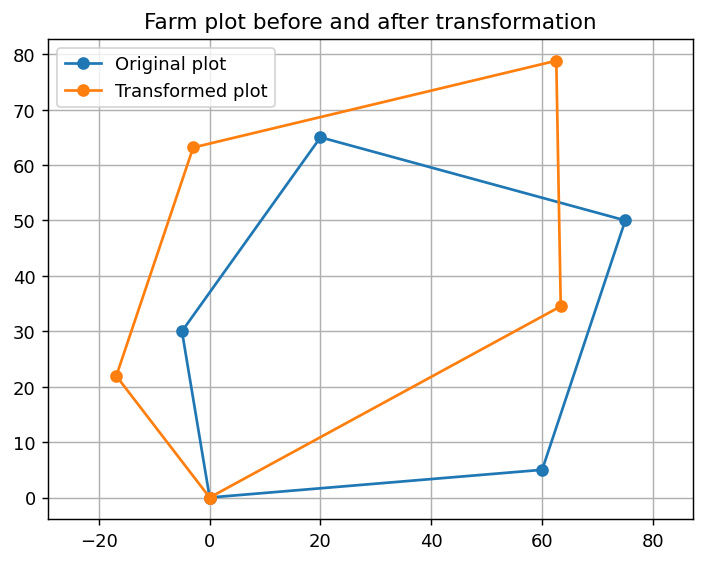

# Task 05: Matrix Algebra and Matrix Operations

**Course:** BIT 2118 Scientific Computing  |  **Student GitHub:** Just-Iann

## 1. The idea in my own words
A matrix can represent a transformation of points: rotate, stretch, mirror. Multiplying a matrix by a point's coordinates moves the point. Combining two transformations is just multiplying their matrices. The determinant tells how much areas are scaled (and whether the shape is flipped).

## 2. Handout program - inputs and operation
Program: [`code/Task_05_matrix_algebra.py`](../code/Task_05_matrix_algebra.py)

**Inputs:** Four corners of a unit square; a rotation of 45 degrees; a scaling of 2 in x and 1.5 in y.

**Mathematical operation:** Build the rotation matrix R and scaling matrix S, combine them as T = R S, and move all points with `points @ T.T`. The determinant det(T) is computed with `np.linalg.det`.

<details><summary>Output of the handout program</summary>

```text
Original: 45 deg, scale (2, 1.5)
Transformation matrix:
[[ 1.4142 -1.0607]
 [ 1.4142  1.0607]]
Transformed points:
[[ 0.      0.    ]
 [ 1.4142  1.4142]
 [ 0.3536  2.4749]
 [-1.0607  1.0607]]
Determinant: 3.0

Change A: 90 deg, scale (2, 1.5)
Transformation matrix:
[[ 0.  -1.5]
 [ 2.   0. ]]
Transformed points:
[[ 0.   0. ]
 [ 0.   2. ]
 [-1.5  2. ]
 [-1.5  0. ]]
Determinant: 3.0

Change B: 45 deg, scale (2, -1.5) -> mirror
Transformation matrix:
[[ 1.4142  1.0607]
 [ 1.4142 -1.0607]]
Transformed points:
[[ 0.      0.    ]
 [ 1.4142  1.4142]
 [ 2.4749  0.3536]
 [ 1.0607 -1.0607]]
Determinant: -3.0
```
</details>

## 3. I changed a parameter
**What I changed:** First I changed the angle to 90 degrees. Second I changed the y-scale from 1.5 to -1.5 (a mirror).

**What happened:** At 90 degrees the square turned into an axis-aligned rectangle, 1.5 wide by 2 high, and the determinant stayed 3: rotation does not change area. With the negative y-scale the determinant became -3. Its size (3) is still the area factor, but the negative sign tells me the shape has been flipped like a mirror image.

## 4. What the output means
The unit square has area 1. After the handout transformation its area is 3 (det = 2 x 1.5 = 3). The transformed corners are the new positions of the square's corners on screen.


## 5. My own real-world case: Re-drawing a farm plot on a rotated, stretched map
Program: [`modified/Task_05_modified_land_plot.py`](../modified/Task_05_modified_land_plot.py)

**Assumptions:** A five-corner plot (in metres), a map rotated by 25 degrees and stretched by 1.2 in x and 0.9 in y. The plot coordinates are made up.

**Input data:** Corners (0,0), (60,5), (75,50), (20,65), (-5,30); matrix M = R(25 deg) x diag(1.2, 0.9).

```text
Transformation matrix:
 [[ 1.0876 -0.3804]
 [ 0.5071  0.8157]]
Area before: 3712.5 m2 | after: 4009.5 m2
|det(M)| = 1.0800 | area ratio = 1.0800
Inverse check (M^-1 M = I): True
Recovered original corners: True
```

**Interpretation:** The plot's area was 3,712.5 m2 before and 4,009.5 m2 after, and the ratio is exactly 1.08, which equals |det(M)| = 1.2 x 0.9. The rotation alone does not change the area, only the stretch does. Multiplying by the inverse matrix gave back the original corners exactly, so a surveyor could undo a map distortion with M inverse.


