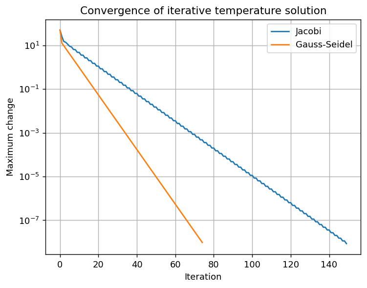
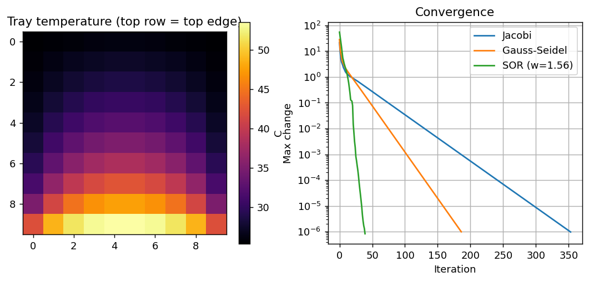

# Task 08: Iterative Methods for Linear Systems

**Course:** BIT 2118 Scientific Computing  |  **Student GitHub:** Just-Iann

## 1. The idea in my own words
Instead of solving all equations at once, an iterative method guesses, then improves the guess using the current values of the other unknowns, and repeats until the change is tiny. Jacobi uses only the previous round's values. Gauss-Seidel uses the newest values immediately, so it usually converges faster.

## 2. Handout program - inputs and operation
Program: [`code/Task_08_iterative_linear.py`](../code/Task_08_iterative_linear.py)

**Inputs:** A 5x5 tridiagonal matrix (steady-state temperature along a bar), b = [100, 0, 0, 0, 20] for boundaries 100 C and 20 C, a start guess of all zeros, and tolerance 1e-8.

**Mathematical operation:** Jacobi: x_new = (b - R x)/D. Gauss-Seidel: update each unknown in turn using the freshest values. Stop when the largest change is below the tolerance.

<details><summary>Output of the handout program</summary>

```text
Jacobi        : [86.6667 73.3333 60.     46.6667 33.3333] (150 iterations)
Gauss-Seidel  : [86.6667 73.3333 60.     46.6667 33.3333] (75 iterations)
Direct        : [86.6667 73.3333 60.     46.6667 33.3333]

--- Parameter change 1: looser tolerance 1e-3 ---
Jacobi iterations: 70 | Gauss-Seidel iterations: 35

--- Parameter change 2: more grid points ---
n= 5: Jacobi   150 iterations, Gauss-Seidel    75 iterations
n=10: Jacobi   486 iterations, Gauss-Seidel   245 iterations
n=20: Jacobi  1672 iterations, Gauss-Seidel   842 iterations
n=40: Jacobi  5935 iterations, Gauss-Seidel  2993 iterations
```
</details>

## 3. I changed a parameter
**What I changed:** First I loosened the tolerance from 1e-8 to 1e-3. Second I increased the number of grid points n from 5 to 10, 20 and 40.

**What happened:** With tolerance 1e-3 the iteration counts fell from 150 to 70 (Jacobi) and from 75 to 35 (Gauss-Seidel), so a looser tolerance saves work but gives a less accurate answer. With more grid points the counts exploded: Jacobi needed 150, 486, 1,672 and 5,935 iterations for n = 5, 10, 20, 40, and Gauss-Seidel about half as many each time. Each doubling of n multiplies the work by about 3.2 to 3.6, which is why big grids are expensive.

## 4. What the output means
Both methods reach the same temperatures as the direct solver: 86.67, 73.33, 60.00, 46.67, 33.33 C, falling in a straight line from the hot 100 C end to the 20 C end. The graph (log scale) shows the error dropping in a straight line, so each iteration reduces the error by a constant factor, and the Gauss-Seidel line is steeper than Jacobi.




## 5. My own real-world case: Temperature on a solar drying tray (2-D grid)
Program: [`modified/Task_08_modified_solar_dryer.py`](../modified/Task_08_modified_solar_dryer.py)

**Assumptions:** A 10x10 grid of interior points (100 unknowns). The bottom edge is heated to 60 C and the other three edges stay at 25 C. I compared Jacobi, Gauss-Seidel and SOR (Gauss-Seidel with an over-relaxation factor w = 1.56).

**Input data:** A 100x100 matrix with 4 on the diagonal and -1 for each neighbour, boundary values in b, tolerance 1e-6.

```text
Jacobi            :  354 iterations | max difference from direct solve 2.32e-05
Gauss-Seidel      :  187 iterations | max difference from direct solve 1.16e-05
SOR (w=1.56)      :   40 iterations | max difference from direct solve 7.46e-07
Temperature next to hot edge: 49.8 C | next to top edge: 25.8 C | centre: 35.1 C
```

**Interpretation:** Jacobi needed 354 iterations, Gauss-Seidel 187 and SOR only 40, and all three agree with the direct solution to within 2e-5 or better. The temperature next to the hot edge averages 49.8 C, the centre is 35.1 C and the row next to the top edge is 25.8 C, so heat fades quickly away from the heated side. For a food-drying tray that tells me the far side of the tray dries much slower than the side near the heat, so trays may need to be rotated. The heat map and the convergence plot are below.


