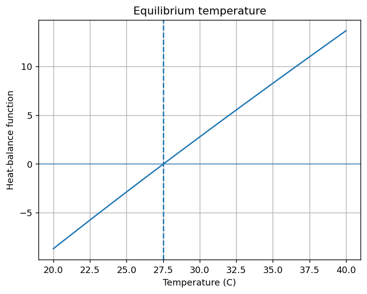
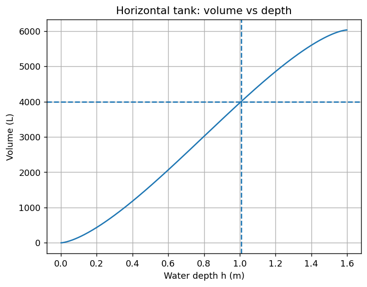

# Task 10: Root Finding: Bisection and Fixed-Point Methods

**Course:** BIT 2118 Scientific Computing  |  **Student GitHub:** Just-Iann

## 1. The idea in my own words
A root is a value that makes f(x) = 0. Bisection starts with two points where f has opposite signs, so a root must be between them, then keeps halving the interval. It is slow but safe. Fixed-point iteration rewrites the equation as x = g(x) and just keeps applying g, which is fast when it works but it only converges if |g'(x)| < 1 near the root.

## 2. Handout program - inputs and operation
Program: [`code/Task_10_bisection_fixed_point.py`](../code/Task_10_bisection_fixed_point.py)

**Inputs:** Heat balance f(T) = T - 25 - 10 exp(-T/20), bracket [20, 40], tolerance 1e-10, and the fixed-point form g(T) = 25 + 10 exp(-T/20) starting at T = 30.

**Mathematical operation:** Bisection halves the bracket until it is smaller than the tolerance. Fixed point repeats T_new = g(T) until two values are within 1e-10.

<details><summary>Output of the handout program</summary>

```text
[c=10]  Bisection: 27.525211 C (38 iterations) | Fixed-point: 27.525211 C (13 iterations)

--- Parameter change: c = 300 ---
[c=300] Bisection: 49.832546 C (40 iterations)
[c=300] Fixed-point iterates: [40.   65.6  36.29 73.88 32.46 84.19 29.46 93.78 27.76 99.88] ... (does not settle)
|g'(root)| for c=10 : 0.126 | for c=300: 1.242
```
</details>

## 3. I changed a parameter
**What I changed:** I changed the heat source strength from 10 to 300 (and widened the bracket to [20, 80]).

**What happened:** Bisection still worked, finding T = 49.8325 C in 40 halvings. Fixed-point iteration broke down: the values went 40, 65.6, 36.3, 73.9, 32.5, 84.2... oscillating wider and wider. The reason is |g'(root)| = 1.24 for c = 300 (greater than 1), compared with 0.126 for c = 10. So bisection is robust and fixed point depends on the slope condition.

## 4. What the output means
For the handout case both methods give the equilibrium temperature 27.525211 C, bisection in 38 steps and fixed point in only 13. The graph crosses zero at that temperature: below it the function is negative (heat gain bigger than loss), above it is positive.




## 5. My own real-world case: Water depth in a horizontal cylindrical tank
Program: [`modified/Task_10_modified_horizontal_tank.py`](../modified/Task_10_modified_horizontal_tank.py)

**Assumptions:** A tank lying on its side, length 3.0 m and radius 0.8 m, holding 4,000 L. Volume as a function of depth h is non-linear (a circular segment), so I solve V(h) = 4 m3 for h. I wrote my own bisection and checked it with SciPy's `brentq`.

**Input data:** L = 3.0 m, r = 0.8 m, target volume 4 m3, bracket from 0 to 1.6 m (the diameter), tolerance 1e-6.

```text
Full tank volume: 6032 L (check: pi r^2 L = 6032 L)
Depth for 4000 L: 1.00736 m  (63.0% of the diameter) after 20 halvings
Check: volume at that depth = 3999.997 L | SciPy brentq gives 1.00736 m
First four bracket intervals: [(0.0, 1.6), (0.8, 1.6), (0.8, 1.2), (1.0, 1.2)]
  1000 L -> depth 0.3560 m
  3000 L -> depth 0.7967 m
  5000 L -> depth 1.2360 m
```

**Interpretation:** A full tank holds 6,032 L (matching pi r^2 L). 4,000 L needs a depth of 1.00736 m, which is 63% of the diameter, found after 20 halvings and confirmed by SciPy. The check gives 3,999.997 L. The bracket shrank (0, 1.6), (0.8, 1.6), (0.8, 1.2), (1.0, 1.2) and so on. Other volumes: 1,000 L at 0.356 m, 3,000 L at 0.797 m, 5,000 L at 1.236 m. Because the shape is curved, the depth is not proportional to the volume, so a simple dipstick marked evenly would give wrong litres.


