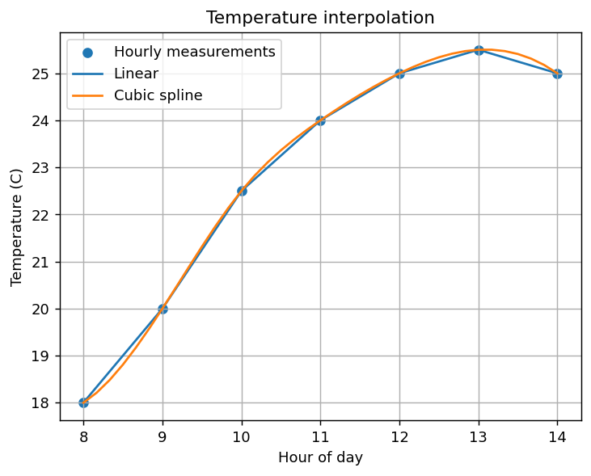
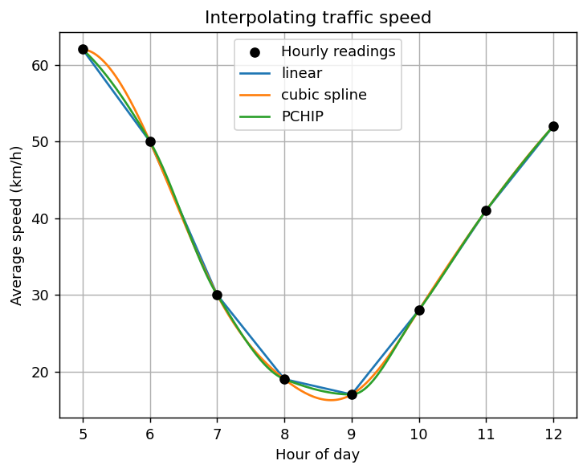

# Task 13: Interpolation

**Course:** BIT 2118 Scientific Computing  |  **Student GitHub:** Just-Iann

## 1. The idea in my own words
Interpolation estimates values between known data points. Linear interpolation joins points with straight lines. A cubic spline joins them with smooth curves so the slope is continuous. PCHIP is a smooth method that avoids overshooting.

## 2. Handout program - inputs and operation
Program: [`code/Task_13_interpolation.py`](../code/Task_13_interpolation.py)

**Inputs:** Temperatures at hours 8 to 14 (18.0, 20.0, 22.5, 24.0, 25.0, 25.5, 25.0), with the estimate wanted at 10:30 and every 10 minutes.

**Mathematical operation:** `interp1d` (linear) and `CubicSpline` build functions from the data and then are evaluated at new times.

<details><summary>Output of the handout program</summary>

```text
Linear estimate at 10:30: 23.25 C
Cubic estimate at 10:30: 23.36 C

--- Parameter change: remove the 11:00 reading (true value 24.0) ---
Linear estimate at 11:00: 23.750 C  (error 0.250)
Cubic  estimate at 11:00: 24.109 C  (error 0.109)
```
</details>

## 3. I changed a parameter
**What I changed:** I hid the 11:00 reading (whose true value is 24.0) and asked both methods to estimate it from the others.

**What happened:** Linear estimated 23.75 C (error 0.25) and the cubic spline estimated 24.109 C (error 0.109). The spline is better here because the data bends smoothly, while a straight line cannot capture the curve.

## 4. What the output means
At 10:30 the linear estimate is 23.25 C and the cubic spline gives 23.36 C. They differ slightly because the temperature curve is concave. In the graph the dots are real measurements, and both curves pass through them but differ in between.




## 5. My own real-world case: Filling in traffic speed between hourly readings
Program: [`modified/Task_13_modified_thika_road_speed.py`](../modified/Task_13_modified_thika_road_speed.py)

**Assumptions:** Illustrative average vehicle speeds on a busy highway from 05:00 to 12:00 (62, 50, 30, 19, 17, 28, 41, 52 km/h). I compared linear, cubic spline and PCHIP with a leave-one-out test (hide one reading, predict it, repeat).

**Input data:** 8 hourly speeds, estimates at 07:30, 08:30 and 09:15.

```text
Speed at 7:30 -> {'linear': 24.5, 'cubic spline': 23.3, 'PCHIP': 23.1}
Speed at 8:30 -> {'linear': 18.0, 'cubic spline': 16.5, 'PCHIP': 17.6}
Speed at 9:15 -> {'linear': 19.8, 'cubic spline': 18.8, 'PCHIP': 18.2}

Leave-one-out test (hide one interior reading, predict it):
  linear        mean error 3.58 km/h | worst 6.50 km/h
  cubic spline  mean error 2.58 km/h | worst 4.51 km/h
  PCHIP         mean error 2.90 km/h | worst 5.64 km/h
```

**Interpretation:** At 07:30 the methods estimate 24.5 (linear), 23.3 (cubic) and 23.1 (PCHIP) km/h. In the leave-one-out test the mean errors were 3.58 km/h (linear), 2.58 km/h (cubic spline) and 2.90 km/h (PCHIP), so the cubic spline did best here. The data bends sharply around the morning jam, which a straight line cannot follow. With only 8 points this is a small test, and a spline can overshoot on other data, so I would not claim one method always wins.


