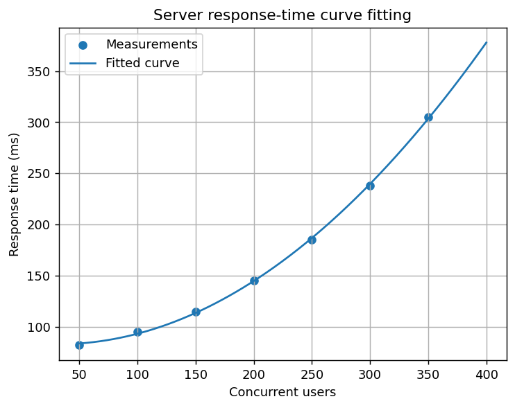
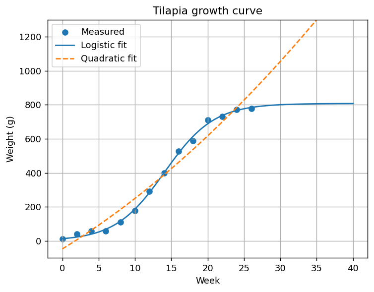

# Task 14: Curve Fitting and Approximation

**Course:** BIT 2118 Scientific Computing  |  **Student GitHub:** Just-Iann

## 1. The idea in my own words
Curve fitting picks the parameters of a chosen model so the curve passes as close as possible to noisy data. Least squares does this by minimising the sum of the squared residuals (observed minus predicted). The model must make sense: a good fit inside the data range can still give nonsense outside it.

## 2. Handout program - inputs and operation
Program: [`code/Task_14_curve_fitting.py`](../code/Task_14_curve_fitting.py)

**Inputs:** Concurrent users (50 to 350) and measured server response times (82 to 305 ms), with a quadratic model a x^2 + b x + c.

**Mathematical operation:** `curve_fit` finds a, b, c that minimise the squared residuals. RMSE = sqrt(mean of squared residuals) measures the typical error, and the model predicts the response at 400 users.

<details><summary>Output of the handout program</summary>

```text
Original      : y = 0.002167x^2 + -0.1345x + 85.00 | RMSE 1.55 ms | prediction at 400 users 377.9 ms
With outlier  : y = 0.000524x^2 + 0.6048x + 35.71 | RMSE 35.96 ms | prediction at 400 users 361.4 ms
```
</details>

## 3. I changed a parameter
**What I changed:** I corrupted one measurement: at 250 users I changed 185 ms to 300 ms (a bad reading).

**What happened:** The fitted curve changed completely: RMSE jumped from 1.55 ms to 35.96 ms, the coefficients became a = 0.000524, b = 0.6048 (from 0.002167 and -0.1345) and the prediction at 400 users moved from 377.9 ms to 361.4 ms. One bad point has a big effect on least squares because the residual is squared. I should inspect residuals and remove or investigate outliers.

## 4. What the output means
The fitted equation is y = 0.002167 x^2 - 0.1345 x + 85.00 with RMSE 1.55 ms, so the model follows the data to within about 1.5 ms. The curve bends upward, meaning each extra user slows the server more than the one before. The predicted response at 400 users is about 378 ms, which is an extrapolation and should be treated with caution.




## 5. My own real-world case: Growth curve of farmed tilapia
Program: [`modified/Task_14_modified_tilapia_growth.py`](../modified/Task_14_modified_tilapia_growth.py)

**Assumptions:** Synthetic data generated from a logistic curve (maximum 800 g, growth rate 0.30 per week, midpoint week 14) plus random noise of 15 g, measured every 2 weeks for 26 weeks. Fish growth levels off, so I compared a logistic model with a quadratic one.

**Input data:** 14 weights at weeks 0, 2, ..., 26.

```text
Logistic fit: Wmax = 807.3 +/- 13.6 g | k = 0.295 +/- 0.013 per week | t0 = 14.07 +/- 0.20 weeks
R^2 = 0.9979 | RMSE = 13.2 g
Predicted week to reach 500 g: 15.7
Quadratic fit RMSE: 57.5 g
Prediction at week 40 -> logistic 807 g | quadratic 1563 g (fish cannot shrink!)
```

**Interpretation:** The logistic fit recovered Wmax = 807.3 +/- 13.6 g, k = 0.295 +/- 0.013 per week and t0 = 14.07 +/- 0.20 weeks, all close to the true values I used to generate the data, with R^2 = 0.998 and RMSE 13.2 g (the size of the noise). Solving the model backwards, a fish reaches 500 g at about week 15.7. The quadratic fit had an RMSE of 57.5 g, and at week 40 it predicted 1,563 g while the logistic one predicted 807 g, which shows why choosing a model that matches the biology matters more than just getting a curve through the points. The standard errors come from the covariance matrix returned by `curve_fit`.


