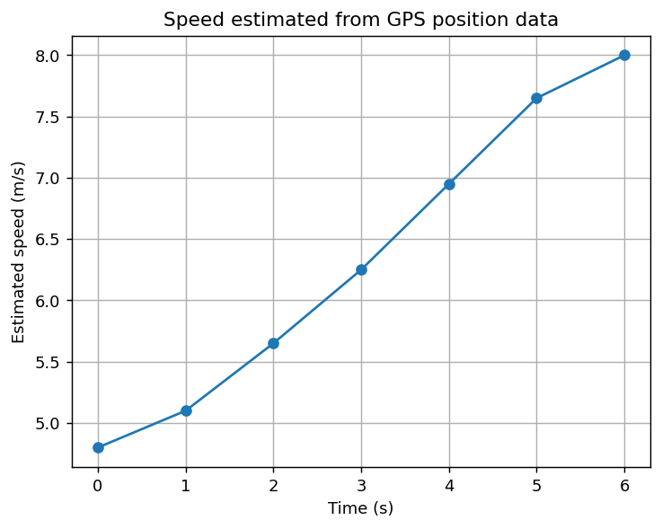
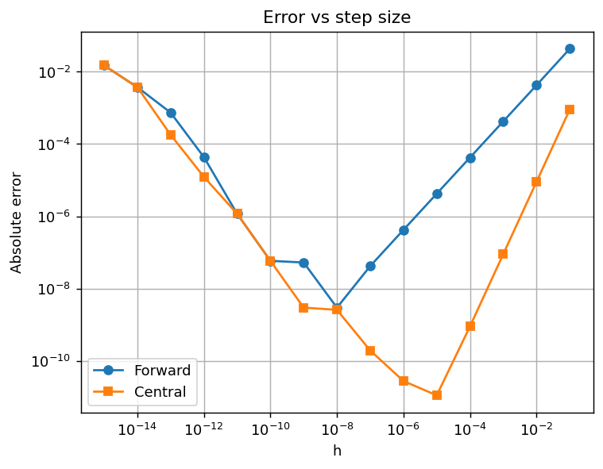

# Task 15: Numerical Differentiation

**Course:** BIT 2118 Scientific Computing  |  **Student GitHub:** Just-Iann

## 1. The idea in my own words
A derivative is a rate of change, and when I only have data points I estimate it with differences. Forward difference (f(x+h) - f(x))/h has error proportional to h. Central difference (f(x+h) - f(x-h))/(2h) has error proportional to h squared, so it is usually much better. But if h is too small, round-off error takes over.

## 2. Handout program - inputs and operation
Program: [`code/Task_15_numerical_differentiation.py`](../code/Task_15_numerical_differentiation.py)

**Inputs:** GPS times 0 to 6 s and positions 0.0, 4.8, 10.2, 16.1, 22.7, 30.0, 38.0 m.

**Mathematical operation:** Forward difference at the first point, central differences in the middle, backward difference at the last point, each divided by the time gap. This gives speed in m/s.

<details><summary>Output of the handout program</summary>

```text
t=0s, position=0.0m, estimated speed=4.80m/s
t=1s, position=4.8m, estimated speed=5.10m/s
t=2s, position=10.2m, estimated speed=5.65m/s
t=3s, position=16.1m, estimated speed=6.25m/s
t=4s, position=22.7m, estimated speed=6.95m/s
t=5s, position=30.0m, estimated speed=7.65m/s
t=6s, position=38.0m, estimated speed=8.00m/s

--- Parameter change: step size h for f(x)=sin(x) at x=1 (exact derivative cos(1)) ---
h=1e-01  forward error=4.29e-02  central error=9.00e-04
h=1e-03  forward error=4.21e-04  central error=9.01e-08
h=1e-05  forward error=4.21e-06  central error=1.11e-11
h=1e-07  forward error=4.18e-08  central error=1.94e-10
h=1e-09  forward error=5.25e-08  central error=2.97e-09
h=1e-11  forward error=1.17e-06  central error=1.17e-06
h=1e-13  forward error=7.34e-04  central error=1.79e-04
h=1e-15  forward error=1.48e-02  central error=1.48e-02
Best forward h ~ 1e-08, best central h ~ 1e-05
```
</details>

## 3. I changed a parameter
**What I changed:** I tested the step size h from 0.1 down to 1e-15 on the function sin(x) at x = 1, where I know the exact derivative cos(1).

**What happened:** The forward error shrank in proportion to h (4.3e-2, 4.2e-4, 4.2e-6 for h = 0.1, 1e-3, 1e-5) and the central error in proportion to h squared (9.0e-4, 9.0e-8, 1.1e-11). Below about h = 1e-8 the errors started growing again, reaching 1.5e-2 at h = 1e-15, because subtracting two nearly equal numbers loses digits. The best h was around 1e-8 for forward and 1e-5 for central differences.

## 4. What the output means
The estimated speed rises steadily from 4.80 m/s to 8.00 m/s, so the vehicle is accelerating by roughly 0.5 to 0.7 m/s every second. The end points use one-sided differences and are less accurate than the middle ones. The first graph shows speed vs time, the second shows the error vs step size with the typical V shape.






## 5. My own real-world case: How fast is a water tank emptying?
Program: [`modified/Task_15_modified_tank_outflow.py`](../modified/Task_15_modified_tank_outflow.py)

**Assumptions:** Synthetic tank levels from L(t) = 3000 - 6t - 0.03t^2 - 0.0004t^3 litres every 10 minutes for 2 hours, with a clean version and a version with +/-3 L sensor noise. I compared forward difference (h = 10), central difference (h = 10) and central difference over a wider span (h = 20).

**Input data:** 13 level readings, true derivative -6 - 0.06t - 0.0012t^2 known for checking.

```text
No noise                     forward h=10: 1.060 | central h=10: 0.040 | central h=20: 0.160  (mean abs error, L/min)
With +/-3 L sensor noise     forward h=10: 1.093 | central h=10: 0.223 | central h=20: 0.146  (mean abs error, L/min)

 t(min)  true  central h=10 (noisy data)
    20   -7.68     -7.46
    30   -8.88     -8.71
    40  -10.32    -10.41
    50  -12.00    -12.29
    60  -13.92    -14.09
    70  -16.08    -15.92
    80  -18.48    -18.16
    90  -21.12    -21.23
   100  -24.00    -24.47

At t=60 min the tank loses about 13.9 L/min; at t=110 min about 27.1 L/min (the made-up outflow grows over time).
```

**Interpretation:** With no noise the central difference (h = 10) has a mean error of 0.040 L/min, forward 1.060 and the wider central (h = 20) 0.160, so a smaller step and a central formula win. With sensor noise the picture changes: the central h = 10 error rose to 0.223 L/min while the wider central h = 20 was better at 0.146, because a wider span averages out noise. So there is a trade-off between truncation error (favours small h) and noise (favours larger h). The estimated outflow is about 13.9 L/min at t = 60 min and about 27.1 L/min at t = 110 min in this made-up data.
