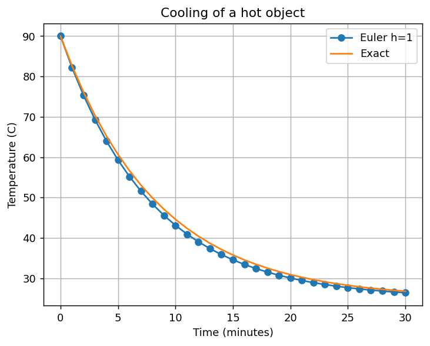
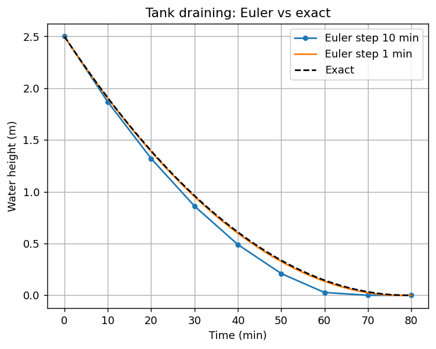

# Task 17: Ordinary Differential Equations - Euler Method

**Course:** BIT 2118 Scientific Computing  |  **Student GitHub:** Just-Iann

## 1. The idea in my own words
An ODE gives the rate of change, and Euler's method walks forward in small steps: new value = old value + step x rate. It is simple but each step introduces a small error. Smaller steps mean better accuracy but more calculations, and a step that is too large can even make the solution blow up.

## 2. Handout program - inputs and operation
Program: [`code/Task_17_euler_ode.py`](../code/Task_17_euler_ode.py)

**Inputs:** Newton's cooling law dT/dt = -k (T - T_ambient) with T_ambient = 25 C, T(0) = 90 C, k = 0.12 per minute, step h = 1 minute, 30 minutes.

**Mathematical operation:** Repeat T_next = T + h x (-k (T - 25)) and compare with the exact solution T = 25 + 65 exp(-k t).

<details><summary>Output of the handout program</summary>

```text
k = 0.12
  h=5.0 : Euler 25.2662 C | exact 26.7760 C | error 1.5098
  h=2.0 : Euler 26.0595 C | exact 26.7760 C | error 0.7165
  h=1.0 : Euler 26.4041 C | exact 26.7760 C | error 0.3720
  h=0.5 : Euler 26.5870 C | exact 26.7760 C | error 0.1890
  h=0.1 : Euler 26.7378 C | exact 26.7760 C | error 0.0383
k = 0.5, h = 5 (k*h = 2.5 > 2): first values [  90.   -72.5  171.2 -194.4  354.1 -468.6]
```
</details>

## 3. I changed a parameter
**What I changed:** I used step sizes h = 5, 2, 1, 0.5, 0.1, and also a deliberately large step with a faster k (k = 0.5, h = 5).

**What happened:** At 30 minutes the error was 1.5098 C for h = 5, 0.7165 for h = 2, 0.3720 for h = 1, 0.1890 for h = 0.5 and 0.0383 for h = 0.1. The error is about proportional to h, as expected for a first-order method. With k = 0.5 and h = 5 (k x h = 2.5, above the limit of 2) the values went 90, -72.5, 171.2, -194.4, ... swinging wildly, so Euler became unstable.

## 4. What the output means
After 30 minutes Euler (h = 1) says 26.40 C and the exact value is 26.78 C, so the object has cooled almost to the room temperature of 25 C. The graph shows the Euler dots slightly below the exact curve, a small but visible error.




## 5. My own real-world case: A water tank draining through a hole
Program: [`modified/Task_17_modified_tank_draining.py`](../modified/Task_17_modified_tank_draining.py)

**Assumptions:** Torricelli's law: dh/dt = -k sqrt(h), with initial height 2.5 m and k = 0.04 per minute (in m^0.5 per minute). The exact solution is known: sqrt(h) = sqrt(h0) - k t/2, so the tank empties at t = 2 sqrt(h0)/k. I stop the height at 0 so it cannot go negative.

**Input data:** h0 = 2.5 m, k = 0.04, steps 10, 5, 1 and 0.1 minutes.

```text
Exact time to empty: 79.06 minutes
step 10.0 min: height at 60 min = 0.0267 m | exact 0.1453 m | error 0.1186 m
step  5.0 min: height at 60 min = 0.0888 m | exact 0.1453 m | error 0.0565 m
step  1.0 min: height at 60 min = 0.1343 m | exact 0.1453 m | error 0.0109 m
step  0.1 min: height at 60 min = 0.1442 m | exact 0.1453 m | error 0.0011 m
Euler (step 5) says the tank is empty at t = 70.0 min
```

**Interpretation:** The exact emptying time is 79.06 minutes. At 60 minutes the exact height is 0.1453 m. Euler's error was 0.1186 m for a 10-minute step, 0.0565 for 5, 0.0109 for 1 and 0.0011 for 0.1. With a 5-minute step Euler said the tank was empty at 70 minutes, almost 9 minutes too early. The square root has an infinite slope at zero, which makes Euler struggle near the end. The graph shows that coarse steps drain the tank too fast.


