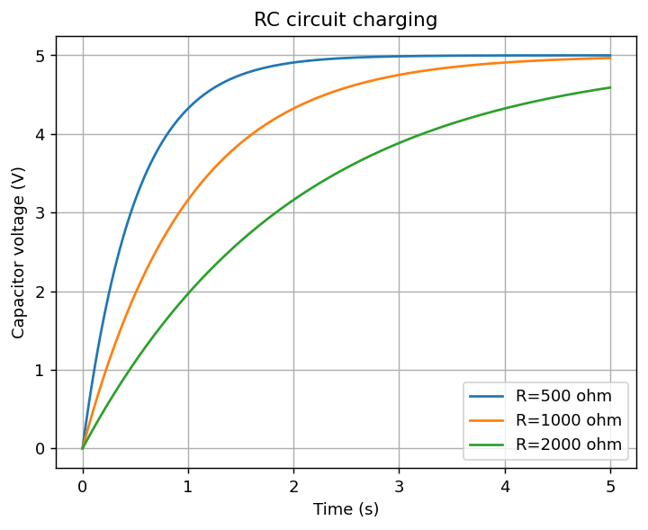
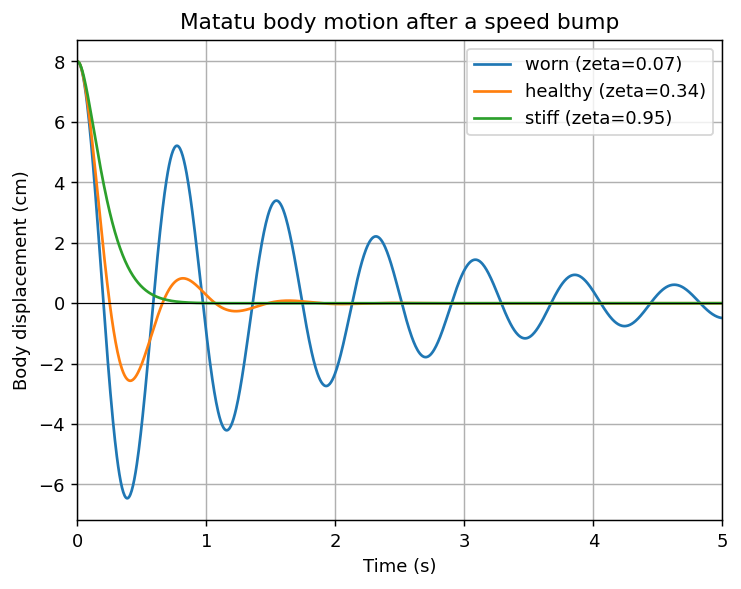

# Task 18: Numerical Solution of ODEs Using SciPy

**Course:** BIT 2118 Scientific Computing  |  **Student GitHub:** Just-Iann

## 1. The idea in my own words
`solve_ivp` is a professional ODE solver that picks its own step sizes to stay within a tolerance. I only supply the rate function, the time span and the starting value. For a second-order equation like a spring, I rewrite it as two first-order equations (position and velocity).

## 2. Handout program - inputs and operation
Program: [`code/Task_18_scipy_ode.py`](../code/Task_18_scipy_ode.py)

**Inputs:** RC circuit with supply 5 V, R = 1000 ohm, C = 0.001 F, V(0) = 0, time 0 to 5 s, tolerances rtol = 1e-9 and atol = 1e-11.

**Mathematical operation:** Solve dV/dt = (Vs - V)/(RC) numerically and compare with the exact curve V = Vs (1 - exp(-t/RC)).

<details><summary>Output of the handout program</summary>

```text
R=  1000 ohm tau=1.0s | V(1 s)=3.161 V | V(5 s)=4.9663 V | max error 9.28e-10 V
R=  2000 ohm tau=2.0s | V(1 s)=1.967 V | V(5 s)=4.5896 V | max error 6.74e-10 V
R=   500 ohm tau=0.5s | V(1 s)=4.323 V | V(5 s)=4.9998 V | max error 9.70e-10 V
```
</details>

## 3. I changed a parameter
**What I changed:** I changed the resistance R to 2000 and to 500 ohm.

**What happened:** The time constant tau = RC changed from 1 s to 2 s and 0.5 s. At 1 s the capacitor reached 3.161 V (63% of 5 V) for R = 1000, only 1.967 V for R = 2000 and 4.323 V for R = 500. At 5 s the voltages were 4.9663, 4.5896 and 4.9998 V. So a bigger resistance charges the capacitor more slowly. The solver error stayed around 1e-9 V in all three cases.

## 4. What the output means
The capacitor charges quickly at first, then slowly levels off near the 5 V supply. After one time constant (1 s) it is at 63.2% of the supply, after five time constants it is almost full. The numerical and exact curves lie on top of each other.




## 5. My own real-world case: A matatu body bouncing after a speed bump
Program: [`modified/Task_18_modified_matatu_suspension.py`](../modified/Task_18_modified_matatu_suspension.py)

**Assumptions:** A quarter-vehicle model: m y'' + c y' + k y = 0 with m = 450 kg and k = 30,000 N/m, starting 8 cm above rest. I compared worn shock absorbers (c = 500), healthy ones (c = 2,500) and stiff ones (c = 7,000 N s/m). This is a simplified model (no tyre, no road profile).

**Input data:** The two first-order equations y' = v and v' = -(c v + k y)/m, solved for 10 seconds.

```text
Natural frequency 1.30 Hz | critical damping c = 7348 N s/m
worn     c=   500 damping ratio 0.07 | settles (2%) after 6.98 s | zero-crossings 18 | lowest point -6.46 cm
healthy  c=  2500 damping ratio 0.34 | settles (2%) after 1.35 s | zero-crossings 3 | lowest point -2.57 cm
stiff    c=  7000 damping ratio 0.95 | settles (2%) after 0.65 s | zero-crossings 0 | lowest point -0.00 cm
```

**Interpretation:** The natural frequency is 1.30 Hz and critical damping is c = 7,348 N s/m. Worn absorbers (damping ratio 0.07) kept bouncing, with 18 zero-crossings and about 7 seconds to settle within 2%, and the body dips as low as 6.46 cm below rest. Healthy ones (ratio 0.34) settled in 1.35 s with 3 crossings and a 2.57 cm dip. Stiff ones (ratio 0.95) settled in 0.65 s without crossing zero. So replacing worn shocks takes the ride from a long bounce to under 2 seconds. Very stiff damping settles fastest but would feel harsh on rough roads, which this model does not capture.


