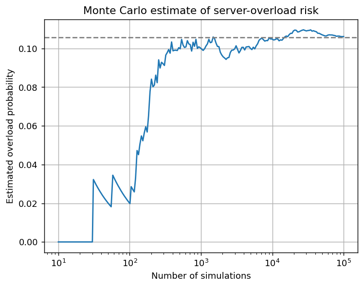
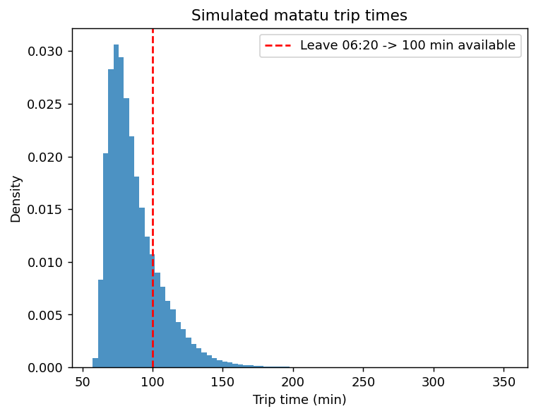

# Task 20: Random Numbers and Monte Carlo Methods

**Course:** BIT 2118 Scientific Computing  |  **Student GitHub:** Just-Iann

## 1. The idea in my own words
Monte Carlo methods answer a question by simulating it many times with random inputs and counting how often an event happens. The estimated probability = (number of times it happened)/(number of simulations), and it gets more reliable as the number of simulations grows. A fixed random seed makes the results repeatable.

## 2. Handout program - inputs and operation
Program: [`code/Task_20_monte_carlo.py`](../code/Task_20_monte_carlo.py)

**Inputs:** Server capacity 1,000, demand ~ Normal(mean 850, standard deviation 120), N = 100,000 simulated scenarios, seed 42.

**Mathematical operation:** Generate random demands, mark those greater than capacity, and take the mean of the True/False array as the overload probability. Compare with the exact normal-tail probability.

<details><summary>Output of the handout program</summary>

```text
Original: estimated 10.6160% | exact (normal tail) 10.5650% | 10616 of 100000
std 120 -> 200        : estimated 22.6020% | exact 22.6627%
mean 850 -> 900       : estimated 20.2210% | exact 20.2328%
N = 1,000 (seed 42)   : estimated 10.1000% | exact 10.5650%
N = 1,000 (seed 7)    : estimated 8.1000% | exact 10.5650%
```
</details>

## 3. I changed a parameter
**What I changed:** I changed the standard deviation to 200, the mean to 900, and the number of simulations to 1,000 with two different seeds.

**What happened:** Standard deviation 200 raised the overload probability from 10.6% to 22.6%, and a mean of 900 raised it to 20.2%. Both match the exact values (22.66% and 20.23%). With only 1,000 simulations the estimate was 10.1% for seed 42 but 8.1% for seed 7, so small simulations are noisy. More runs give stable answers.

## 4. What the output means
About 10.6% of the simulated scenarios exceeded capacity (10,616 out of 100,000). The exact answer from the normal distribution (z = (1000 - 850)/120 = 1.25) is 10.565%, so the simulation is within 0.05 percentage points. The graph shows the running estimate fluctuating at first and settling near 10.6% after thousands of simulations.




## 5. My own real-world case: Will I get to an 08:00 class on time?
Program: [`modified/Task_20_modified_trip_time_risk.py`](../modified/Task_20_modified_trip_time_risk.py)

**Assumptions:** Illustrative model of a matatu trip: free-flow time 55 min, congestion delay lognormal (median 15 min), a Poisson(6) number of extra stops each adding an exponential delay averaging 2 min, and a 10% chance of a breakdown or incident adding 15-45 min. 200,000 simulated trips.

**Input data:** Departure times 06:00, 06:20 and 06:40 and a deadline of 08:00.

```text
Mean trip 87.0 min | median 82.1 | 90th percentile 112.7 | 95th 123.8
Leave 06:00: P(late) = 6.38% (+/- 0.11% at 95% confidence)
Leave 06:20: P(late) = 20.09% (+/- 0.18% at 95% confidence)
Leave 06:40: P(late) = 55.47% (+/- 0.22% at 95% confidence)
To be late at most 5% of the time, leave by 05:56
Only 500 simulations -> P(late, leave 06:20) = 19.2% (compare 20.09% with 200,000)
```

**Interpretation:** The mean trip is 87 minutes, the median 82 and the 95th percentile 124 minutes, so the average is pulled up by the bad days. Leaving at 06:00 gives a 6.4% chance of being late, 06:20 gives 20.1% and 06:40 gives 55.5%. To be late no more than 5% of the time I should leave by about 05:56. Each estimate has a 95% margin of about 0.1 to 0.2 percentage points with 200,000 runs. With only 500 simulations the 06:20 estimate was 19.2% instead of 20.1%, a reminder that few simulations give rougher answers.


